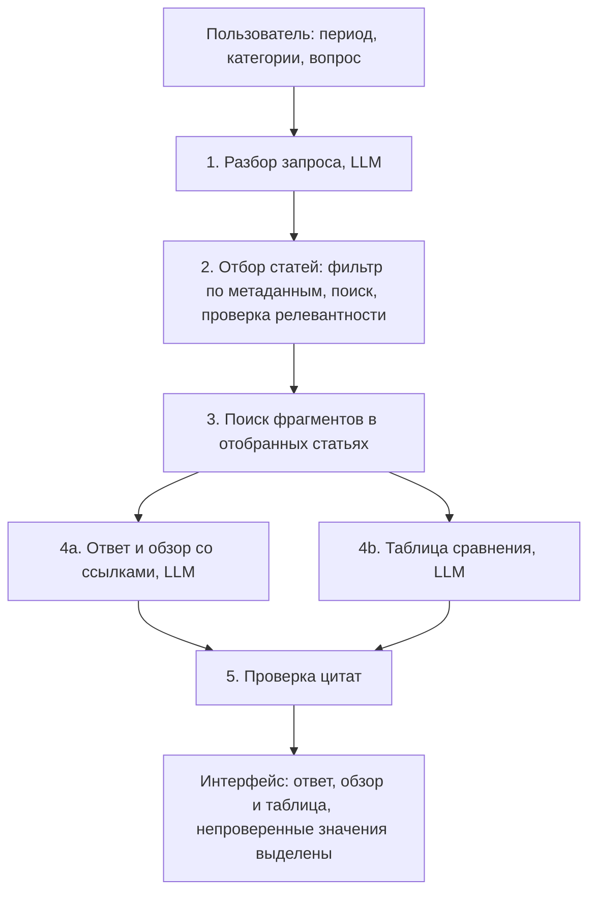

# Чекпоинт 1. Навигатор по научным статьям (arXiv Research Navigator)

**Команда:** NaviGators (Сизова Олеся, Юрина Анастасия, Эбаноидзе Илья)
**Ментор:** Анжела Шумилова
**Дата:** 17.11.2026

## 1. Описание проекта

### 1.1 Проблема

В ML новые подходы появляются в основном как препринты на arXiv, задолго до публикации на конференциях. Поток большой: только по теме RAG в категориях `cs.CL`, `cs.AI`, `cs.IR`, `cs.LG` выходит 200–400 статей в месяц (наш корпус, [data/STATS.md](../data/STATS.md)).

Чтобы понять, какие подходы к задаче появились за год, нужно просмотреть сотни аннотаций, открыть десятки статей и вручную свести методы, датасеты и метрики в таблицу. В аннотациях этих данных обычно нет: они в разделе экспериментов и в таблицах результатов.

Раньше такую сводку для ML частично давал Papers with Code (связка «статья — метод — датасет — метрика»), но в июле 2025 года его закрыли, а лидерборды по задачам больше не поддерживаются.

Общие LLM-чаты отвечают быстро, но выдумывают статьи и цифры. Проверить такой ответ нельзя, поэтому всё равно приходится перечитывать статьи самому.

### 1.2 Пользователь и его задачи

**Основной пользователь** — студент магистратуры или аспирантуры либо ML-инженер, который разбирается в незнакомой подобласти ML. Читает статьи на английском, думает и пишет отчёты на русском. Мы сами такие пользователи: с этой задачей сталкиваемся в учёбе и на работе.

| Ситуация (когда…) | Задача (хочу…) | Результат (чтобы…) | Как делает сейчас |
|---|---|---|---|
| начинаю работу над темой ВКР, статьи или рабочей задачи | быстро увидеть, какие подходы появились за выбранный период | понять, что читать в первую очередь, и не пропустить важное | поиск по arXiv и Google Scholar, просмотр аннотаций, советы коллег |
| выбираю метод или baseline для своей задачи | сравнить методы по датасетам и метрикам | выбрать, с чем сравниваться, и обосновать выбор | открывает каждую статью, вручную ведёт таблицу |
| пишу related work или отчёт для руководителя | получить сводку, где каждое утверждение подтверждено источником | вставить её в текст без перепроверки каждой цифры | пересказывает статьи вручную; LLM-чатам не доверяет из-за выдуманных ссылок |

**Критерии успеха для пользователя:** сводка готова за минуты, а не за дни; любое значение в таблице проверяется за один клик; непроверенные значения видны сразу, а не обнаруживаются при чтении статьи.

### 1.3 Существующие решения

Мы сравнивали решения по пяти требованиям из постановки:
1. сбор статей arXiv по теме, периоду и категориям;
2. ответы на вопросы по многим статьям сразу;
3. таблица «метод / датасеты / метрики» по всем найденным статьям;
4. цитата для каждой ячейки и пометка непроверенных значений;
5. измеренная точность.

**Поисковые системы и читалки** находят статьи и помогают читать **одну** статью. Таблицу по всей выдаче они не строят (требования 3 и 4).

| Решение | Что умеет | Чего не хватает для нашей задачи |
|---|---|---|
| arXiv (поиск на сайте и API) | поиск по ключевым словам с фильтром по категориям и датам | ИИ-функций нет; всё остальное пользователь делает руками |
| Google Scholar, Scholar Labs | самый широкий охват; Scholar Labs (с ноября 2025, экспериментально) ищет статьи по развёрнутому вопросу и поясняет, как каждая на него отвечает; Quick Read кратко пересказывает статью под запрос | работа идёт по одной статье: сравнительной таблицы по выдаче нет; Scholar Labs поддерживает только английский и доступен не всем |
| Semantic Scholar | TLDR из одного предложения, Semantic Reader с подсветкой цели, метода и результата, ответы по одной статье | сводит информацию по одной статье, не по набору статей |
| alphaXiv и другие читалки arXiv с чатом | краткое содержание и чат по конкретной статье arXiv | то же: одна статья за раз, без таблицы и без статуса проверки |

**ИИ-ассистенты для обзора литературы** закрывают требования 2–4. С ними и нужно сравниваться.

| Решение | Что умеет | Чего не хватает для нашей задачи |
|---|---|---|
| Elicit | поиск по базе Semantic Scholar, таблицы с колонками для извлечения данных, цитаты-подтверждения для каждой ячейки | рассчитан на английский язык; сценарии и колонки по умолчанию ориентированы на систематические обзоры (в основном биомедицина); полный функционал платный |
| SciSpace | поиск статей, таблица сравнения с настраиваемыми колонками, ответы с цитатами, чат с PDF | бесплатный тариф сильно ограничен (несколько колонок, нет экспорта); узкого фокуса на свежих препринтах ML нет |
| Ai2 Asta (ScholarQA) | бесплатные отчёты по научным вопросам с таблицами сравнения и фрагментами статей; корпус в основном arXiv; код открыт | ближайший аналог; формат — длинный отчёт по вопросу, а не таблица по выбранному периоду и категориям; явной пометки непроверенных значений в описании системы мы не нашли |
| Consensus | ответы на вопросы с цитатами, оценка согласия исследований | ориентирован на вопросы «да/нет» (работает ли X), не на сравнение методов |

**Прочее**

| Решение | Что умеет | Чего не хватает для нашей задачи |
|---|---|---|
| ChatGPT, Perplexity и другие общие чаты | быстрые ответы на любом языке | выдумывают статьи и значения; нет ссылки на абзац; нет фильтра по периоду и категориям arXiv |
| Hugging Face Papers (наследник Papers with Code) | ленты популярных статей со ссылками на код, модели и датасеты | лидерборды «метод — датасет — метрика» после закрытия Papers with Code не восстановлены; извлечения в таблицу нет |

Общее ограничение зарубежных платных сервисов для пользователей из России — оплата: российские карты ими не принимаются.

**Вывод.** Поисковые системы и читалки работают с одной статьёй, а сводить многие статьи в таблицу приходится вручную. Извлечение в таблицу с цитатами само по себе не новинка: это уже умеют Elicit, SciSpace и Asta. Поэтому мы не позиционируемся как «первый такой инструмент», а делаем узкую версию под конкретного пользователя: отличия перечислены ниже. Asta (ScholarQA) с открытым кодом — кандидат в базовое решение для сравнения, если хватит времени.

### 1.4 Наше решение и чем оно отличается

1. **Узкий фокус:** свежие препринты arXiv по ML с фильтром по периоду и категориям; колонки таблицы заданы под ML — метод, датасеты, метрики.
2. **Явный статус проверки:** каждая ячейка либо подтверждена цитатой со ссылкой прямо на абзац или таблицу статьи (якорь в HTML-версии arXiv), либо помечена как непроверенная. Пользователю не нужно читать цитату, чтобы понять, можно ли доверять значению.
3. **Русскоязычный интерфейс:** вопрос и ответ на русском, статьи и цитаты — на английском, в оригинале.
4. **Измеренное качество:** точность извлечения и доля подтверждённых утверждений считаются на открытом эталоне (раздел 5) и публикуются в README, а не заявляются без проверки.

**Что мы не делаем:** не ищем русскоязычные статьи и не работаем с российскими базами (eLibrary, РИНЦ), потому что на arXiv статьи почти все на английском; не делаем систематические обзоры по стандарту PRISMA; не пишем за пользователя текст статьи.

### 1.5 Что делает система

Пользователь выбирает период и категории arXiv и задаёт вопрос. Система находит подходящие статьи и выдаёт:

- **ответ на вопрос** (например, «какие подходы к X появились за год?») со ссылками на фрагменты статей;
- **короткий обзор подходов** по найденным статьям;
- **таблицу сравнения** с колонками «метод», «датасеты», «метрики».

У каждого утверждения и каждой ячейки есть цитата со ссылкой на абзац или таблицу статьи. Если значение не удалось подтвердить цитатой, оно помечается как непроверенное.

## 2. Роли в команде

Проект делится на три зоны. Кто какую берёт, решаем на созвоне команды 16.11.

| Зона | Что входит |
|---|---|
| Данные и поиск | корпус, индекс и поиск фрагментов, проверка цитат; оценка поиска |
| LLM-пайплайн | ответ со ссылками, обзор, извлечение таблицы; оценка извлечения |
| Приложение | интерфейс, логирование, обработка ошибок; сквозная проверка пользовательского сценария |

Эталон размечаем все вместе. Тесты и README каждый пишет для своей части.

## 3. Данные

### 3.1 Источники

| Источник | Что берём | Для чего |
|---|---|---|
| arXiv API | название, аннотация, авторы, даты, категории | поиск статей, фильтр по периоду и категориям |
| HTML-версии статей arXiv | полный текст с разделами, абзацами и таблицами | основной источник текста; у каждого абзаца есть идентификатор, поэтому ссылка ведёт прямо на него |
| PDF-версии статей arXiv | полный текст | если HTML-версии нет; ссылка ведёт только на страницу |
| arXiv OAI-PMH | лицензия статьи | понять, какие тексты можно показывать полностью |
| Semantic Scholar API | число цитирований, место публикации, краткое содержание (TLDR) | дополнительная информация о статье в интерфейсе, один из сигналов при отборе |
| QASPER | 1 585 статей по NLP, 5 049 вопросов с ответами и фрагментами, где находится ответ | оценка поиска фрагментов и ответов на вопросы |
| ArxivDIGESTables | 2 228 таблиц сравнения из обзорных статей и 7 542 статьи из этих таблиц | примеры реальных таблиц сравнения; возможный дополнительный эталон |

Все источники открыты. arXiv просит делать не больше одного запроса в 3 секунды, поэтому полные тексты скачиваются медленно.

### 3.2 Собранный корпус

Для разработки и оценки мы собрали корпус по теме «RAG и LLM-агенты» за период с 01.11.2025 по 31.10.2026, категории `cs.CL`, `cs.AI`, `cs.IR`, `cs.LG`. Поисковые запросы лежат в [config/corpus.yaml](../config/corpus.yaml).

| Что | Объём |
|---|---|
| Статьи с метаданными | 3 672 |
| Найдены в Semantic Scholar | 3 669 |
| Статьи с полным текстом | 440: 428 из HTML, 11 из PDF, 1 недоступна (отозвана авторами) |
| Фрагменты текста | 43 840: 40 007 абзацев, 3 405 таблиц, 428 аннотаций |
| Статьи под лицензией Creative Commons | 274 из 440 (62%) |
| Объём на диске | около 150 МБ вместе с QASPER и ArxivDIGESTables |

Статьи для полного текста отбирались так: самые цитируемые плюс случайная выборка для разнообразия. Список статей с полным текстом зафиксирован в журнале загрузки, поэтому корпус у всех участников одинаковый. Подробная статистика по месяцам, запросам и лицензиям: [data/STATS.md](../data/STATS.md).

### 3.3 Что мы заметили при сборе

В первой версии корпуса основной запрос по RAG был ограничен 1 000 статей. arXiv отдаёт результаты от новых к старым, а всего статей по запросу 2 244, поэтому в корпус попали только статьи с мая по октябрь 2026. Мы увеличили ограничение до 3 000 и собрали корпус заново. Вывод для приложения: при большом числе результатов статьи нужно отбирать по всему периоду, а не только самые свежие.

В HTML около четверти абзацев вложены в другие абзацы (пункты списков, теоремы), и сначала их текст попадал в корпус дважды. Мы это исправили.

Цитирований у свежих статей мало (медиана 1), поэтому ранжировать по цитируемости нельзя. Кроме того, по запросам находятся статьи, где тема упоминается вскользь. Например, по запросу про длинный контекст и поиск нашёлся технический отчёт Qwen3-VL (3 246 цитирований), хотя он про другое. Значит, после поиска нужна фильтрация по релевантности.

### 3.4 Формат хранения

```
data/
├── raw/                      # скачанные файлы: ответы arXiv API, HTML, PDF
├── processed/
│   ├── papers.parquet        # статьи: метаданные arXiv и Semantic Scholar
│   ├── chunks.jsonl          # фрагменты текста со ссылками на место в статье
│   └── fulltext_log.jsonl    # что скачано, в каком формате, лицензия
├── eval/                     # QASPER и ArxivDIGESTables
└── STATS.md
```

Пример фрагмента:

```json
{"arxiv_id": "2511.21631", "chunk_id": "2511.21631#S3.SS2.SSS1.p1", "type": "paragraph",
 "section": "3.2.1 Image Caption and Interleaved Text-Image Data",
 "url": "https://arxiv.org/html/2511.21631#S3.SS2.SSS1.p1",
 "text": "To build a robust foundation model for general-purpose vision–language understanding, we ..."}
```

По `url` статья открывается сразу на этом абзаце.

Полные тексты в репозиторий не кладём из-за объёма и лицензий: каждый участник скачивает их командой `python scripts/collect.py fulltext` (около 85 МБ, примерно 20 минут), эталонные датасеты — командой `python scripts/collect.py evalsets` (около 60 МБ). Подробности в [README](../README.md).

## 4. Подход и архитектура

### 4.1 Выбор подхода

Мы выбрали RAG по полным текстам статей в виде воркфлоу из отдельных шагов.

Передать модели только аннотации не получится: в них обычно нет датасетов и цифр. Полные тексты десятков статей не помещаются в контекст. Агент со свободным выбором действий здесь не нужен: шаги задачи известны заранее, а агент менее предсказуем, и его сложнее оценивать. В воркфлоу у каждого шага понятный вход и выход, и качество можно измерить для каждого шага отдельно.

Первая версия работает по заранее собранному корпусу (раздел 3.2): пользователь выбирает период и категории внутри него. Так ответ приходит быстро, а метрики считаются на одних и тех же данных. Загрузка статей по новой теме прямо из интерфейса — возможное расширение (см. раздел 7).

### 4.2 Схема



### 4.3 Компоненты

| Компонент | Что делает | Первая реализация |
|---|---|---|
| Сбор и разбор статей | скачивает статьи, режет на фрагменты со ссылками на место в статье | уже написан (`src/navigator/collect/`) |
| Разбор запроса | из текста пользователя получает поисковый запрос на английском, период и категории | LLM со структурированным выводом |
| Отбор статей | находит статьи по запросу в корпусе и отсекает нерелевантные | поиск по названию и аннотации + проверка релевантности LLM |
| Поиск фрагментов | находит в отобранных статьях фрагменты под вопрос или колонку таблицы | BM25 и/или эмбеддинги; что лучше — решим по метрикам на QASPER |
| Ответ и обзор | отвечает по найденным фрагментам со ссылками на них | LLM |
| Таблица сравнения | для каждой ячейки находит значение и цитату | LLM со структурированным выводом |
| Проверка цитат | проверяет, что цитата есть в статье и подтверждает значение | дословная проверка кодом; что не прошло — помечаем как непроверенное |
| Интерфейс | форма запроса, ответ, обзор, таблица со ссылками | веб-приложение (Streamlit или Gradio) |

LLM подключаем через API neuraldeep. Логируем запросы к LLM, время ответа и число токенов. Фреймворк для воркфлоу выберем, когда будем собирать пайплайн.

## 5. План оценки

Обязательные метрики (из постановки задачи и критериев курса):

| Что проверяем | Метрика | Данные |
|---|---|---|
| Точность извлечённых значений | Precision, Recall, F1 по ячейкам таблицы (метод, датасеты, метрики) | наш эталон: не менее 30 статей из корпуса, размеченных вручную по [инструкции](annotation_guide.md) |
| Подтверждённость цитатами | доля утверждений и ячеек, подтверждённых цитатой | ответы системы на вопросы по нашему корпусу и таблицы по статьям эталона |
| Поиск фрагментов | Evidence Recall@k: попал ли нужный фрагмент в первые k | QASPER, подвыборка тестовой части (размер подберём под лимиты API) |
| Ответы на вопросы | Answer F1 (метрика QASPER) | QASPER |

Совпадение значений с эталоном для коротких списков (датасеты, метрики) считаем после нормализации названий. Для поля «метод» нужна проверка смысла; планируем оценку через LLM, выборочно сверенную с ручной.

Если останется время: сравнение с LLM без поиска, согласие разметчиков на пересекающейся части эталона, тест интерфейса на людях, не знакомых с проектом.

## 6. Что уже сделано

- Написан код сбора данных: arXiv API, лицензии, Semantic Scholar, загрузка эталонных датасетов.
- Написан разбор HTML и PDF на фрагменты со ссылками на место в статье.
- Собраны корпус и эталонные датасеты. Проверили, что повторяющихся фрагментов нет и ссылки ведут на существующие абзацы (100 случайных из 100).
- Подготовлена инструкция для разметки эталона.

## 7. Открытые вопросы и блокеры

- **Новая тема из интерфейса.** Из-за ограничения arXiv статья скачивается около 3 секунд, плюс время на обработку LLM. Поэтому первая версия работает по заранее собранному корпусу, а загрузку по новой теме добавим, если останется время.
- **Лицензии.** 38% статей не под Creative Commons. Планируем показывать из них только короткие цитаты со ссылкой на оригинал. *Вопрос ментору: достаточно ли этого?*
- **Разные названия одного и того же** (`HotpotQA` и `Hotpot QA`, `EM` и `Exact Match`) мешают считать F1. Сделаем словарь синонимов. *Вопрос ментору: можно ли использовать оценку через LLM как основную метрику для поля «метод», если мы выборочно проверяем её на ручной разметке?*
- **Объём эталона.** *Вопрос ментору: достаточно ли 30 статей?*
- **Ограничения API** на длину контекста и число запросов. Проверим на прототипе.

## 8. План до чекпоинта 2

1. Индекс и поиск фрагментов, первая метрика на QASPER.
2. Простая рабочая версия пайплайна: вопрос → поиск фрагментов → ответ со ссылками; затем таблица и проверка цитат.
3. Отбор статей для эталона и разметка, первые метрики извлечения.
4. Минимальный интерфейс.
5. Понятная структура репозитория для новых модулей.

## Источники к разделу 1

- [Papers with Code: закрытие в июле 2025 года](https://www.codesota.com/papers-with-code/shutdown)
- [Elicit: извлечение данных и цитаты-подтверждения](https://support.elicit.com/en/articles/4267649)
- [Elicit: работа с языками, кроме английского](https://support.elicit.com/en/articles/11126721)
- [Elicit: систематические обзоры, источники PubMed и ClinicalTrials.gov](https://elicit.com/solutions/systematic-review)
- [SciSpace: сравнение тарифов с Elicit](https://scispace.com/compare/elicit)
- [Ai2 ScholarQA: описание системы](https://arxiv.org/abs/2504.10861)
- [Ai2 ScholarQA: анонс, корпус открытых статей (arXiv)](https://www.infodocket.com/?p=165170)
- [Оплата зарубежных сервисов из России](https://habr.com/ru/articles/1010190/)
- [Google Scholar Labs: анонс, только английский, ограниченный доступ](https://scholar.googleblog.com/2025/)
- [Google Scholar: Quick Read](https://scholar.googleblog.com/)
- [Semantic Scholar: TLDR, Semantic Reader, Ask This Paper](https://www.educatorstechnology.com/2026/09/semantic-scholar-review.html)
- [alphaXiv: краткое содержание и чат по статье](https://pypi.org/project/alphaxiv-py/)
